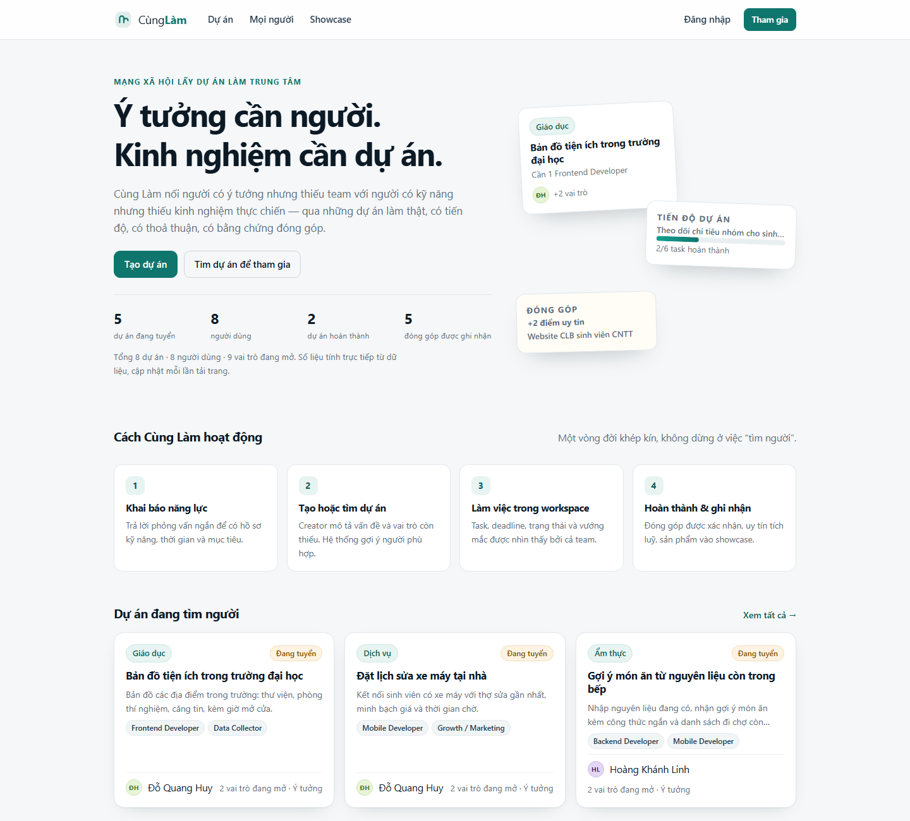
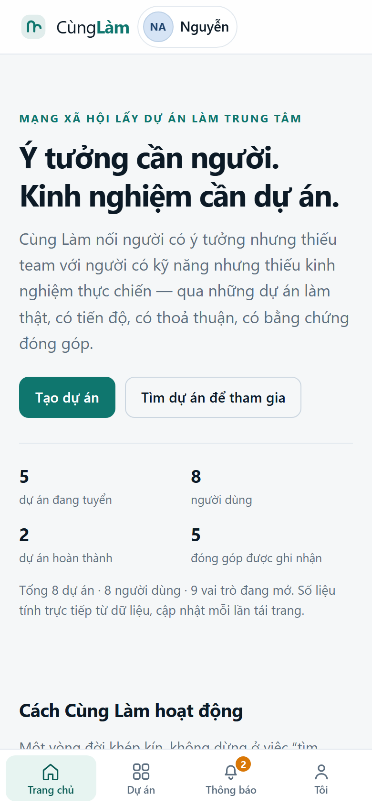
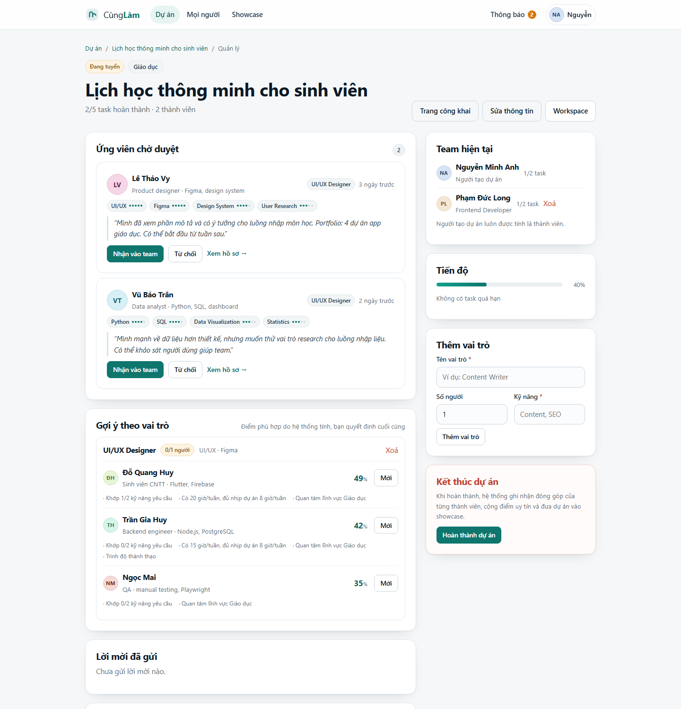
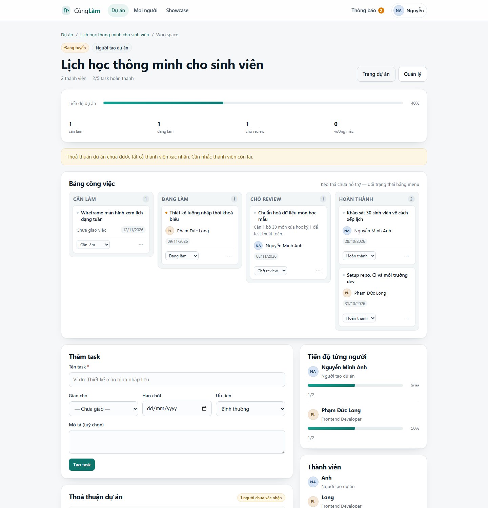
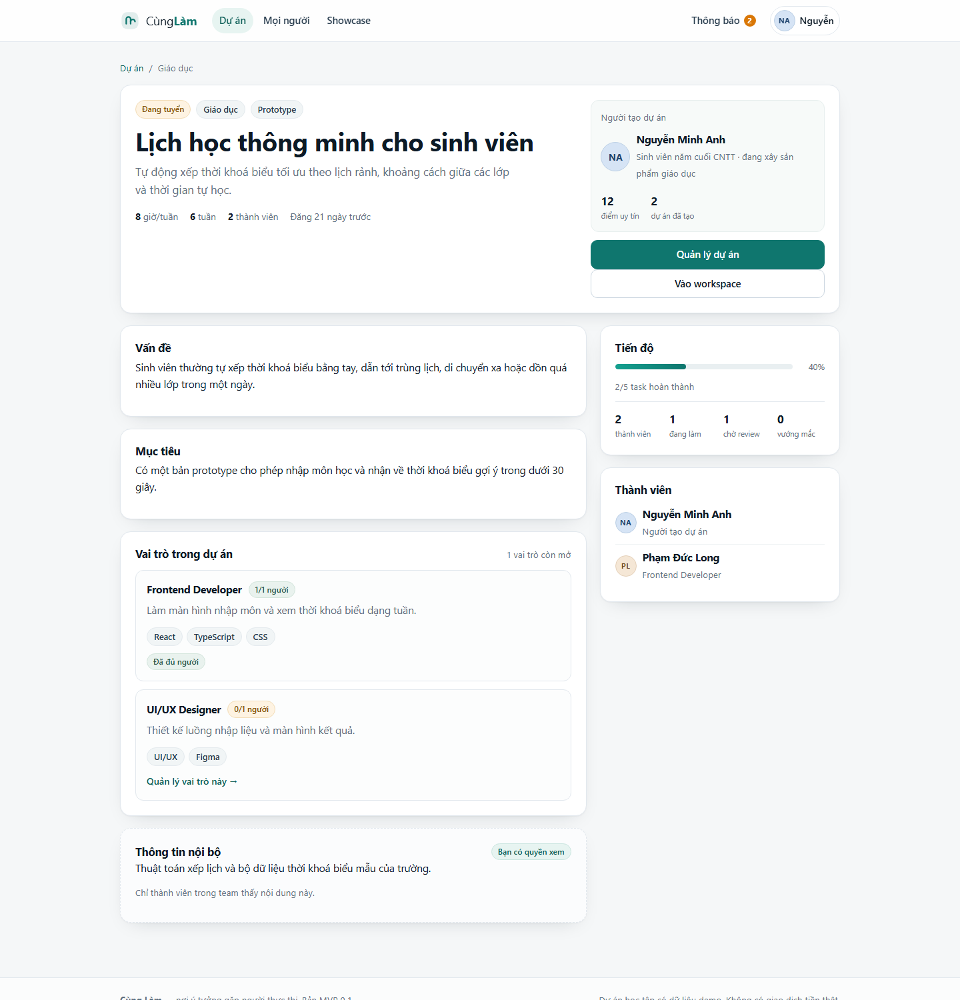
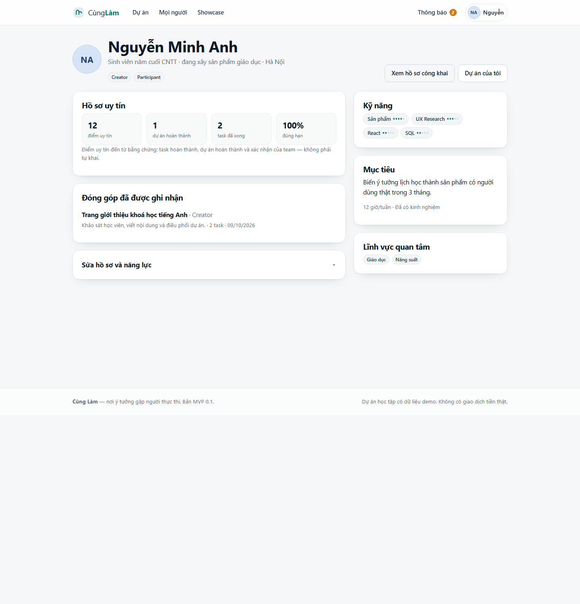
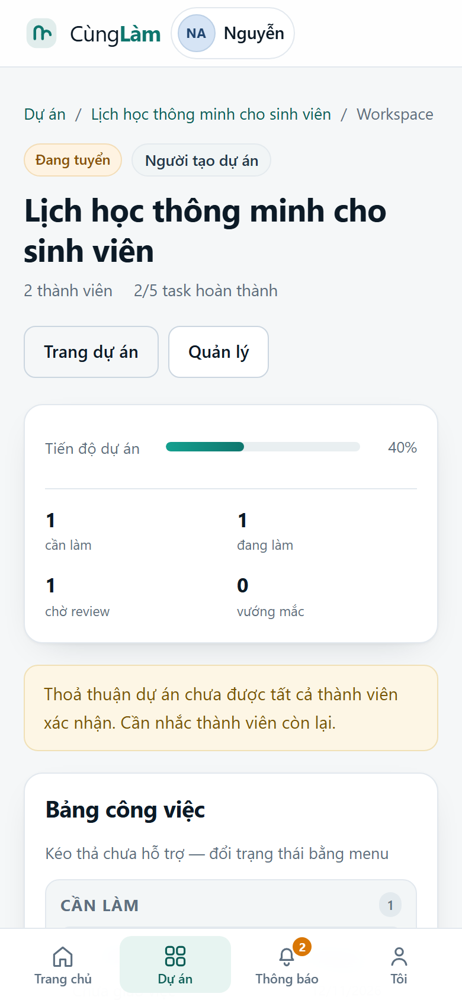

# Cùng Làm — nền tảng kết nối người có ý tưởng với người muốn tích lũy kinh nghiệm thực chiến

  

[](https://render.com/deploy?repo=https://github.com/ahoangzzz2k9/workspace)

Sản phẩm web chạy được thật, hiện thực hoá bản đề xuất **Project_Proposal_Nen_tang_ket_noi_du_an_v0.1**. Đây không phải bản mockup: có cơ sở dữ liệu, đăng nhập, phân quyền, matching, workspace, thoả thuận sở hữu và ghi nhận đóng góp. Ứng dụng **cài được lên điện thoại/máy tính** dưới dạng PWA (icon riêng, chạy toàn màn hình, có trang dự phòng khi mất mạng).

Mọi con số hiển thị (dự án, người dùng, vai trò đang mở, đóng góp) được tính trực tiếp từ SQLite mỗi lần tải trang — không có số liệu trang trí hardcode.

> **Tên "Cùng Làm" là tên tạm** để phát triển sản phẩm. Quyết định #1 trong đề xuất (tên chính thức và nhận diện thương hiệu) vẫn để mở.



## Chạy trong 30 giây

Yêu cầu: **Node.js ≥ 22.5** (dùng `node:sqlite` có sẵn, không cần cài package nào).

```bash
cd cunglam
node server.js
# mở http://127.0.0.1:4321
```

Lần chạy đầu tiên tự tạo database và dữ liệu demo (8 người, 8 dự án). Không cần `npm install` — dự án **zero-dependency**.

Tuỳ chọn:

```bash
PORT=3000 node server.js          # đổi cổng
CUNGLAM_DB=/tmp/cunglam.db node server.js   # đổi đường dẫn DB
node test/run.js                  # chạy 13 test end-to-end
```

Xoá `data/cunglam.db` rồi chạy lại để tạo dữ liệu demo mới.

### Tài khoản demo

Mật khẩu chung: `demo1234`

| Email | Vai trò | Nên xem gì |
|---|---|---|
| `an@cunglam.vn` | Creator + Participant | Tài khoản chính: 2 dự án, 2 ứng viên chờ duyệt, thông báo, hồ sơ uy tín |
| `huy@cunglam.vn` | Creator + Participant | Dự án đã hoàn thành (Website CLB) |
| `vy@cunglam.vn` | Participant | Người vừa ứng tuyển UI/UX, có 2 dự án hoàn thành |
| `quang@cunglam.vn` | Creator + Participant | Có lời mời tham gia đang chờ phản hồi |
| `long@cunglam.vn`, `linh@cunglam.vn`, `tran@cunglam.vn`, `mai@cunglam.vn` | | Các thành viên/ứng viên khác |

## Cài thành app (PWA)



| Nền tảng | Cách cài |
|---|---|
| **Android** (Chrome/Edge) | Mở app → menu trình duyệt → **Cài đặt ứng dụng**; hoặc bấm “Cài đặt” ở banner gợi ý |
| **iPhone/iPad** (Safari) | Nút **Chia sẻ** → **Thêm vào MH chính** |
| **Máy tính** (Chrome/Edge) | Biểu tượng cài đặt trên thanh địa chỉ → cửa sổ riêng |

Sau khi cài: icon riêng trên màn hình chính, mở toàn màn hình (không thanh địa chỉ), thanh tab dưới cho mobile, badge số thông báo chưa đọc trên icon (Android/desktop hỗ trợ), shortcut giữ lâu icon để vào nhanh **Dự án đang tuyển / Thông báo / Tạo dự án**, và **trang offline** thay cho màn hình trắng khi mất mạng.

Điều kiện: **HTTPS hoặc localhost**. Bản này chạy ở `http://127.0.0.1:4321` nên cài được ngay trên máy; khi mở cho điện thoại trong LAN cần HTTPS (reverse proxy/tunnel), nếu không trình duyệt sẽ không cho cài.

> **Vì sao không có file APK/IPA?** Môi trường build này không có Android SDK/JDK, Xcode hay npm registry để dựng React Native/Flutter/Capacitor. PWA là cách duy nhất tạo “app thật” ở đây: cùng một codebase, cài được trên cả ba nền tảng, không cần store. Khi có hạ tầng, có thể bọc thêm bằng Capacitor để phát hành lên CH Play/App Store mà không phải viết lại giao diện.

Thành phần PWA: [`manifest.webmanifest`](public/manifest.webmanifest) (icon 192/512 + maskable, shortcut, screenshot), [`sw.js`](public/sw.js) (precache vỏ app, network-first cho trang, offline fallback), icon sinh tự động trong [`public/icons`](public/icons), trang cài đặt tại `/app`.


## Kịch bản demo 5 phút

1. Đăng nhập `an@cunglam.vn` → **Dự án → Lịch học thông minh**.
2. Bấm **Quản lý**: xem 2 ứng viên, điểm matching + lý do gợi ý, nhận **Lê Thảo Vy** vào vai trò UI/UX.
3. Mở **Workspace**: kéo trạng thái task, giao việc, báo vướng mắc, xác nhận thoả thuận 70/30.
4. Bấm **Hoàn thành dự án** → xem đóng góp được ghi nhận và điểm uy tín trên hồ sơ.
5. Đăng nhập `quang@cunglam.vn` → **Lời mời** để thử luồng được mời.

Kịch bản chi tiết hơn (kèm câu trả lời cho các câu hỏi thường gặp khi demo): [docs/DEMO.md](docs/DEMO.md).

## Giao diện

| Trang quản lý dự án — duyệt ứng viên, gợi ý matching, thoả thuận | Workspace — bảng task và tiến độ |
|---|---|
|  |  |

| Trang dự án (phân tầng thông tin) | Hồ sơ uy tín |
|---|---|
|  |  |

<p align="center"></p>

## Tính năng đã có

| # | Tính năng | Trạng thái |
|---|---|---|
| 1 | Đăng ký / đăng nhập, mật khẩu hash scrypt, session 30 ngày | ✅ |
| 2 | Onboarding kiểu phỏng vấn năng lực: kỹ năng + mức 1–5, trình độ, giờ/tuần, vai trò mong muốn, lĩnh vực, kinh nghiệm, mục tiêu | ✅ |
| 3 | Vai trò Creator / Participant, bật tắt trong hồ sơ | ✅ |
| 4 | Tạo dự án: vấn đề, mục tiêu, giai đoạn, cam kết thời gian, tối đa 3 vai trò kèm kỹ năng, thông tin nội bộ, mức công khai | ✅ |
| 5 | Danh sách + tìm kiếm theo từ khoá, lĩnh vực, trạng thái, kỹ năng | ✅ |
| 6 | Trang dự án phân tầng truy cập: công khai → ứng viên → thành viên (thông tin nội bộ bị khoá) | ✅ |
| 7 | Matching theo kỹ năng/thời gian/lĩnh vực, điểm 0–100 kèm lý do giải thích được | ✅ |
| 8 | Ứng tuyển, mời trực tiếp, chấp nhận/từ chối, tự tạo thoả thuận khi nhận người đầu tiên | ✅ |
| 9 | Workspace: bảng task 4 trạng thái, người phụ trách, deadline, ưu tiên, lý do vướng mắc | ✅ |
| 10 | Tiến độ 3 cấp: task → thành viên → dự án, cảnh báo quá hạn và điểm nghẽn | ✅ |
| 11 | Thoả thuận dự án: điều khoản sở hữu + tỷ lệ % từng người, xác nhận riêng, chặn tổng ≠ 100% | ✅ |
| 12 | Hoàn thành dự án: bản ghi đóng góp, điểm uy tín, đưa vào showcase | ✅ |
| 13 | Hồ sơ uy tín công khai: điểm, dự án hoàn thành, task, tỷ lệ đúng hạn, đóng góp | ✅ |
| 14 | Thông báo trong ứng dụng: ứng tuyển, được nhận, task, review, vướng mắc, thoả thuận, lời mời | ✅ |
| 15 | Rời dự án / creator xoá thành viên, thu hồi quyền truy cập, mở lại vị trí | ✅ |
| 16 | Sửa dự án, thêm/xoá vai trò | ✅ |
| 17 | Danh bạ người dùng + tìm theo tên hoặc kỹ năng | ✅ |
| 18 | **Cài thành app (PWA)**: icon riêng, chạy toàn màn hình, shortcut, badge thông báo, thanh tab mobile | ✅ |
| 19 | **Trang offline** + trạng thái mạng; vỏ ứng dụng được precache, dữ liệu cá nhân không cache | ✅ |

### Chưa làm (thuộc giai đoạn sau, đúng theo đề xuất)

Marketplace mua/bán dự án và chuyển nhượng, gọi vốn, thanh toán/escrow, dịch đa ngôn ngữ trong chat, bot chuyên nhiệm vụ (matching hiện là thuật toán minh bạch, không phải AI), quy trình tranh chấp, xác minh kỹ năng, email xác thực/quên mật khẩu, upload file/avatar, chat realtime, **push notification từ server** (hiện chỉ có thông báo trong app + badge), **app native trên store** (APK/IPA).

## Kiến trúc

**Zero-dependency**: Node HTTP server thuần + `node:sqlite` + server-side rendering. Không bundler, không framework, không bước build. Một lệnh là chạy.

```
cunglam/
├── server.js              # HTTP server, session, router, xử lý lỗi
├── src/
│   ├── db.js              # schema SQLite + transaction helper
│   ├── seed.js            # dữ liệu demo (8 người, 8 dự án, task, thoả thuận…)
│   ├── auth.js            # scrypt, session token (lưu hash), cookie
│   ├── http.js            # router, form body, static, same-origin check
│   ├── views.js           # layout + component HTML (esc, avatar, chips, progress…)
│   ├── data.js            # truy vấn dự án/thành viên/task/uy tín, thông báo
│   ├── match.js           # thuật toán matching + gợi ý theo vai trò
│   └── routes/
│       ├── auth.js        # đăng nhập, đăng ký, onboarding
│       ├── projects.js    # danh sách, chi tiết, tạo/sửa, ứng tuyển
│       ├── manage.js      # duyệt ứng viên, mời, thoả thuận, hoàn thành, xoá thành viên
│       ├── workspace.js   # kanban, task, tiến độ
│       └── me.js          # hồ sơ, thông báo, lời mời, people, showcase
├── public/
│   ├── style.css          # giao diện + app shell (tab bar, safe-area, standalone)
│   ├── app.js             # PWA, cài đặt, badge, offline, progressive enhancement
│   ├── manifest.webmanifest
│   ├── sw.js              # service worker: precache vỏ app + offline fallback
│   ├── icons/             # icon 192/512, maskable, apple-touch, favicon
│   └── screenshots/       # ảnh cho hộp thoại cài đặt
├── tools/                 # sinh icon, chụp ảnh mobile qua DevTools Protocol
├── Dockerfile             # image Node 24, chạy bằng docker compose
├── docker-compose.yml
├── .env.example           # cấu hình môi trường
├── LICENSE                # MIT
├── CHANGELOG.md
├── CONTRIBUTING.md
├── .github/workflows/ci.yml  # CI: kiểm tra cú pháp + 13 test
├── test/app.test.js       # 13 test end-to-end qua HTTP thật
└── docs/                  # ảnh chụp, DEPLOY.md, kịch bản demo
```

### Mô hình dữ liệu

`users`, `user_roles`, `profiles` (kỹ năng dạng JSON `[{name, level}]`), `sessions`, `projects`, `project_roles`, `applications`, `invites`, `memberships`, `tasks`, `agreements` + `agreement_parts`, `contributions`, `reputation_events`, `notifications`.

Mọi thay đổi nhiều bước (nhận ứng viên, hoàn thành dự án, xoá thành viên) chạy trong transaction.

### Quy tắc nghiệp vụ

**Matching** (hiển thị công khai cho người dùng, không phải hộp đen):

```
điểm = 58% mức khớp kỹ năng + 22% thời gian rảnh so với cam kết
     + 12% cùng lĩnh vực quan tâm + 8% trình độ
```

Kỹ năng khớp được cộng theo mức tự khai (1–5); thiếu kỹ năng bắt buộc bị trừ tương ứng. Bot chỉ đề xuất — creator quyết định cuối cùng.

**Uy tín** (chỉ tính từ bằng chứng, không phải tự khai):

| Sự kiện | Điểm |
|---|---|
| Mỗi task hoàn thành (khi dự án kết thúc) | +1 |
| Hoàn thành dự án với vai trò thành viên | +6 |
| Creator điều phối dự án đến khi hoàn thành | +4 |

Tỷ lệ đúng hạn tính trên các task có deadline và đã hoàn thành.

**Thoả thuận sở hữu**: mỗi dự án có một agreement gồm điều khoản + tỷ lệ từng thành viên. Hệ thống chia đều khi nhận người đầu tiên, cho phép creator sửa nhưng tổng phải đúng 100%, và reset trạng thái xác nhận của người bị đổi tỷ lệ. Nền tảng không tự phán "ai xứng đáng bao nhiêu" — đúng nguyên tắc trong đề xuất.

**Phân tầng thông tin**: mô tả công khai → thông tin nội bộ (`sensitive_note`) chỉ mở cho creator và thành viên đã được nhận; khi rời dự án, quyền truy cập bị thu hồi ngay.

## Bảo mật

- Mật khẩu: `scrypt` với salt riêng từng người, so sánh bằng `timingSafeEqual`.
- Session: token 32 byte ngẫu nhiên, **chỉ lưu SHA-256 trong DB**, cookie `HttpOnly; SameSite=Lax`.
- POST kiểm tra `Origin` / `Sec-Fetch-Site` (chống CSRF cơ bản).
- CSP `default-src 'self'`, `X-Frame-Options: DENY`, `nosniff`, escape toàn bộ output.
- Giới hạn độ dài mọi trường nhập; body tối đa 512 KB.
- Service worker chỉ precache **vỏ ứng dụng + trang offline công khai**; không cache HTML chứa dữ liệu người dùng, nên đăng xuất không làm lộ dữ liệu qua cache.

**Chưa có** (cần bổ sung trước khi mở công khai): xác thực email, giới hạn tần suất đăng nhập, quên/đổi mật khẩu, 2FA, audit log đầy đủ, backup tự động. SQLite phù hợp một máy chủ; muốn scale cần chuyển Postgres.

## Kiểm thử

```bash
node test/run.js
```

13 test chạy trên HTTP server thật với SQLite in-memory, bao phủ: render công khai, đăng nhập sai/đúng, phân quyền workspace (403), chặn ứng tuyển khi chưa onboarding, luồng đầy đủ tạo dự án → ứng tuyển → nhận → task → hoàn thành → uy tín → showcase, lời mời, thông báo, tìm kiếm, sửa dự án, xoá thành viên, 404.

## Những quyết định còn mở trong đề xuất

| Quyết định | Trạng thái trong MVP |
|---|---|
| Tên chính thức & thương hiệu | Tạm dùng "Cùng Làm" |
| Quy tắc Reputation chi tiết | Đã có công thức tối giản, cần chốt hình phạt/khôi phục |
| Cơ chế Ownership/Revenue | Đã có agreement + tỷ lệ %, chưa có thanh toán thật |
| Mẫu Project Agreement | Có bản nháp trong code, cần luật sư xem |
| Quy trình dispute/moderation | Chưa làm — mới có báo vướng mắc trong task |
| Mức độ verification kỹ năng | Chưa làm, hiện dựa trên tự khai + bằng chứng dự án |
| Quy tắc công khai/riêng tư | Có public/unlisted + phân tầng nội bộ |
| Marketplace & transfer | Chưa làm (ngoài MVP) |
| MVP & tiêu chí thành công | 17 tính năng ở trên; cần chốt chỉ số |
| Kiến trúc kỹ thuật & dữ liệu | Đã có bản chạy được (xem trên) |

## Đưa lên GitHub

Repo đã sẵn sàng: không chứa database, file build, log hay bí mật (xem `.gitignore`). Máy chưa có git thì cài [Git for Windows](https://git-scm.com/download/win) trước, rồi:

```bash
git init -b main
git add .
git commit -m "feat: Cùng Làm MVP 0.3.0"
git remote add origin https://github.com/<tài-khoản>/cunglam.git
git push -u origin main
```

Hoặc chạy script có sẵn: `pwsh tools/publish_github.ps1 -Remote https://github.com/<tài-khoản>/cunglam.git` (tự kiểm tra git, init, commit, push).

Gợi ý khi tạo repo: mô tả *“Mạng xã hội dự án cho sinh viên — Node.js + SQLite + PWA”*, topic `nodejs`, `sqlite`, `pwa`, `vietnamese`, `students`. GitHub Actions sẽ tự chạy CI ở lần push đầu.

## Triển khai máy chủ

Ứng dụng chỉ cần một process Node và một file SQLite. **GitHub Pages không chạy được** vì trang render phía server và cần SQLite ghi được — GitHub chỉ lưu mã nguồn.

Cách nhanh nhất có HTTPS: đẩy repo lên GitHub rồi bấm **Deploy to Render** (repo có sẵn `render.yaml`, plan Free chạy ngay không cần thẻ; đổi sang Starter + disk nếu muốn giữ dữ liệu). Hoặc tự chạy trên VPS:

```bash
cp .env.example .env      # sửa CUNGLAM_SEED=0, COOKIE_SECURE=true
docker compose up -d --build
curl http://127.0.0.1:4321/health
```

Chi tiết Render, VPS, Caddy/Nginx, HTTPS, backup và checklist bảo mật: [docs/DEPLOY.md](docs/DEPLOY.md).

## Cấu hình môi trường

| Biến | Mặc định | Ý nghĩa |
|---|---|---|
| `HOST` | `127.0.0.1` | Địa chỉ lắng nghe; đặt `0.0.0.0` khi chạy container |
| `PORT` | `4321` | Cổng HTTP, tự thử cổng kế tiếp nếu bận |
| `CUNGLAM_DB` | `./data/cunglam.db` | Đường dẫn SQLite |
| `CUNGLAM_SEED` | `1` | `0` = không tạo dữ liệu demo |
| `COOKIE_SECURE` | `auto` | `true` khi chạy sau HTTPS |
| `TRUST_PROXY` | `0` | `1` nếu đứng sau reverse proxy |

Server tự đọc `.env` ở thư mục gốc (không cần dotenv).

## Đóng gói để tải về

Chạy `pwsh tools/package_windows.ps1` (hoặc `pwsh -File tools/package_windows.ps1 -Version 0.3.0`) để tạo trong `dist/`:

| Gói | Nội dung | Dùng khi nào |
|---|---|---|
| `CungLam-0.3.0-win64.zip` (~36 MB) | App + `node/node.exe` (Node 24, giấy phép MIT) + `CHAY-CUNG-LAM.bat` + `HUONG-DAN-NHANH.txt` | Máy Windows 64-bit, **không cần cài Node**. Giải nén ra Desktop/Documents rồi nhấp đúp file `.bat` |
| `CungLam-0.3.0-source.zip` (~2 MB) | Toàn bộ mã nguồn, test, tài liệu, công cụ | Máy đã có Node ≥ 22.5 (Windows/macOS/Linux): `node server.js` |

Bản win64 tự mở trình duyệt tại `http://127.0.0.1:4321`, dữ liệu nằm trong `app/data` (xoá để reset demo). File `node.exe` chưa ký số nên Windows SmartScreen có thể hỏi — chọn *More info → Run anyway*.

**Lịch sử lỗi đã sửa:** bản 0.2.0 có thể thoát ngay khi khởi động vì lệnh tự mở trình duyệt ném `spawn EPERM`. Bản 0.2.1 bắt lỗi này và tự chuyển cổng khi 4321 bận. Bản **0.2.2** tách việc mở trình duyệt sang `MO-TRINH-DUYET.ps1` (do `CHAY-CUNG-LAM.bat` gọi), ghi URL thật vào `app/data/url.txt`, nên trình duyệt vẫn mở đúng cổng dù Node không spawn được tiến trình.

## Khắc phục sự cố khi chạy bản đóng gói

| Hiện tượng | Nguyên nhân thường gặp | Cách xử lý |
|---|---|---|
| Cửa sổ đen hiện rồi tắt, trình duyệt báo không kết nối | Giải nén thiếu file; SmartScreen chặn `node.exe` | Giải nén lại cả thư mục; SmartScreen → *More info → Run anyway*; chạy `CHAY-CUNG-LAM.bat` từ Command Prompt để đọc lỗi |
| Trình duyệt không tự mở | Windows chặn spawn tiến trình từ Node | Nhấp đúp `MO-TRINH-DUYET.bat`, hoặc mở địa chỉ trong dòng `CÙNG LÀM ĐÃ SẴN SÀNG` |
| Trình duyệt báo “không kết nối được” | Cổng 4321 bị ứng dụng khác chiếm | App tự chuyển 4322…; mở đúng địa chỉ in trong cửa sổ đen |
| Trang trắng hoặc giao diện cũ | Service worker còn cache bản trước | `Ctrl + F5`; hoặc DevTools → Application → Service workers → Unregister |
| Muốn reset dữ liệu demo | — | Xoá thư mục `app/data` rồi chạy lại |

## Giấy phép & dữ liệu

Mã nguồn phát hành theo giấy phép [MIT](LICENSE). Dữ liệu trong repo là dữ liệu demo hư cấu; không có giao dịch tiền thật.


